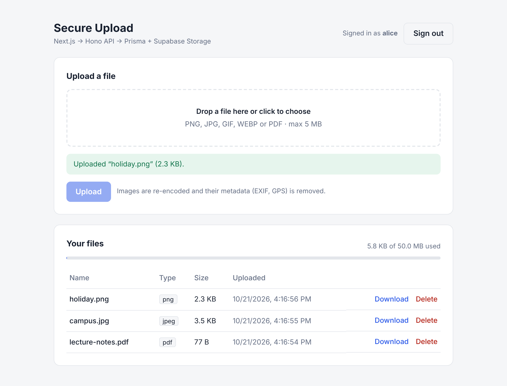
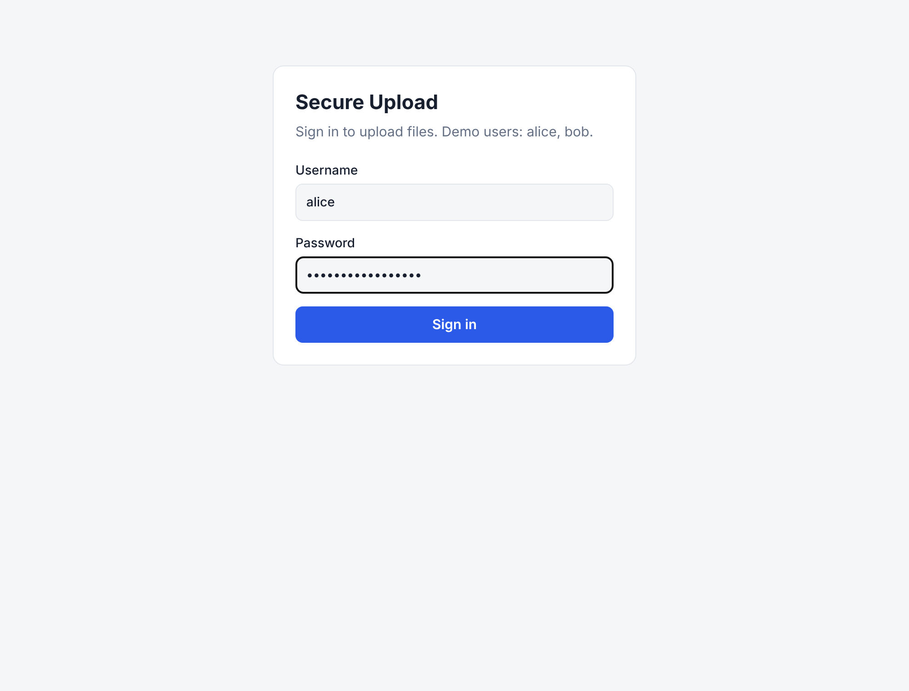
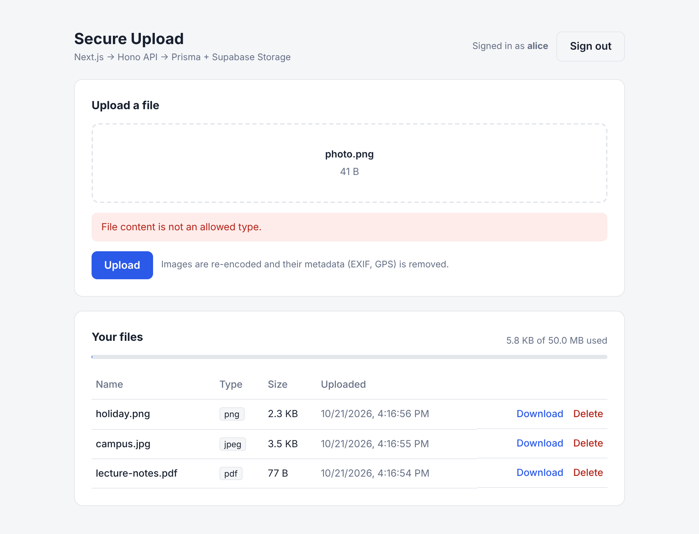
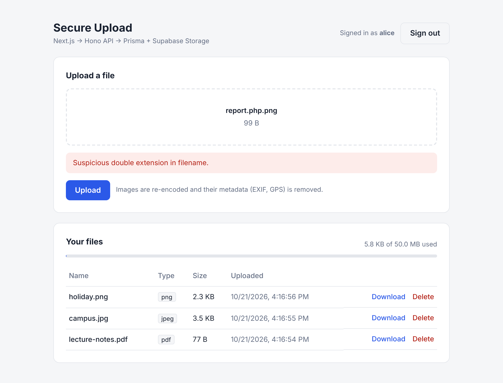
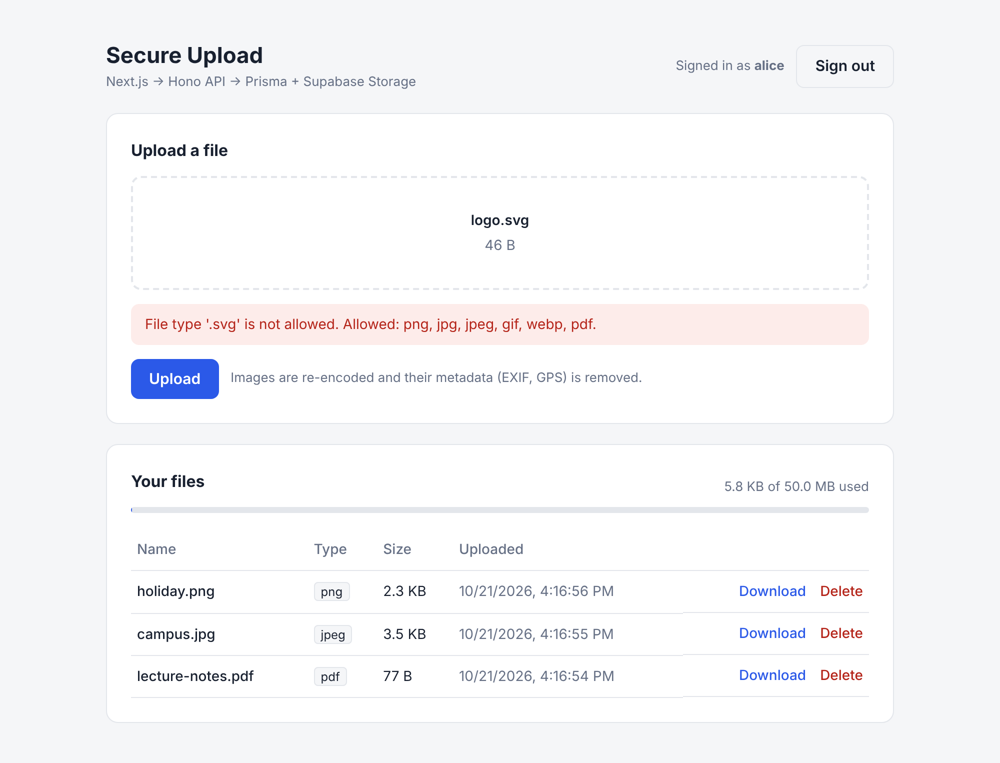
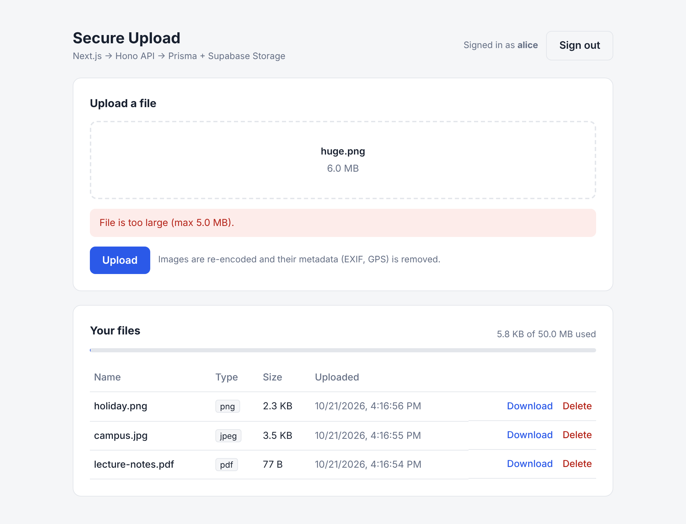
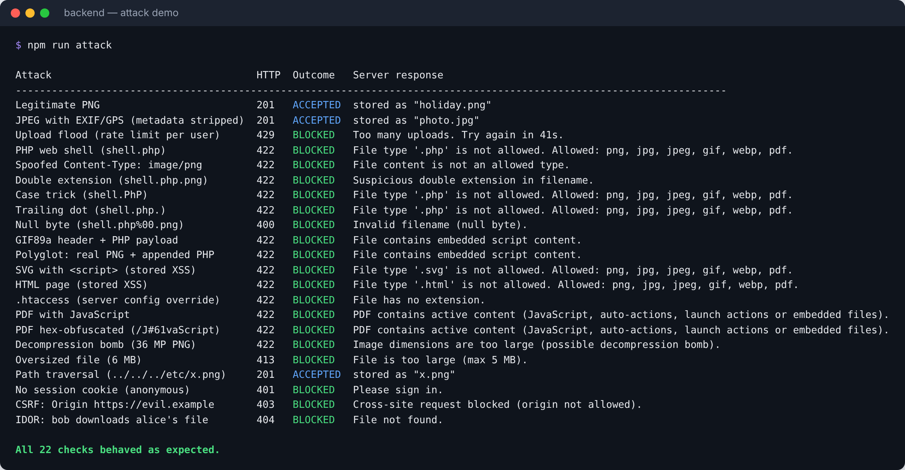
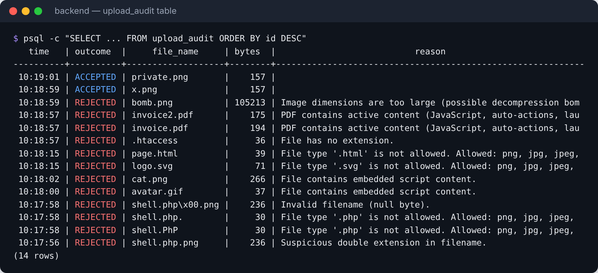
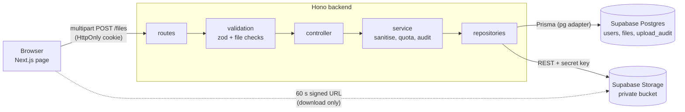

# Secure File Upload: Next.js + Hono + Prisma + Supabase Storage

**WEB404 Secure Coding Practices: Server-Side Attacks**

A small web app where signed-in users upload images and PDFs. It shows how a file
upload feature becomes a vulnerability, and how to build one that is safe by
validating, sanitising and isolating every file before it is stored.



---

## Contents

1. [What is file upload?](#1-what-is-file-upload)
2. [Where the vulnerability actually occurs](#2-where-the-vulnerability-actually-occurs)
3. [Prevention: how this project defends each point](#3-prevention-how-this-project-defends-each-point)
4. [Screenshots: the defences in action](#4-screenshots-the-defences-in-action)
5. [What to keep in mind (checklist)](#5-what-to-keep-in-mind-checklist)
6. [Architecture and project structure](#6-architecture-and-project-structure)
7. [Supabase environment variables](#7-supabase-environment-variables)
8. [Running the project](#8-running-the-project)
9. [Limitations and production notes](#9-limitations-and-production-notes)
10. [References](#10-references)

---

## 1. What is file upload?

File upload lets a user send a file from their device to a server: a profile
picture, an assignment PDF, a receipt photo. In the browser it is a form with
`<input type="file">`. The file is sent as a **`multipart/form-data`** HTTP
request that contains three things the server receives:

| Part of the request | Example | Who controls it? |
|---|---|---|
| Filename | `holiday.png` | **The user** |
| `Content-Type` header | `image/png` | **The user** |
| File bytes | `89 50 4E 47 ...` | **The user** |

That is the core problem: **every part of an upload is chosen by the client.**
The server then usually does several risky things with it. It writes the file to
disk or cloud storage, parses it (image libraries, PDF readers), and later serves
it back to other users' browsers.

In this project the flow is:

```
Browser (Next.js) ──multipart──▶ Hono API ──validate + sanitise──▶ Supabase Storage (private bucket)
                                     │
                                     └──metadata──▶ Postgres (via Prisma)
```

---

## 2. Where the vulnerability actually occurs

An upload is dangerous because of **what happens to the file after it arrives**,
not because a file arrived. There are six places where trust goes wrong. This is
"unrestricted file upload", tracked as **CWE-434**.

### 2.1 Trusting client-side checks
`accept=".png,.jpg"` on the input and JavaScript size checks only affect the
normal UI. Anyone can send the HTTP request directly (curl, Burp Suite, DevTools)
and skip them completely.
**Where it occurs:** the server assumes the browser already validated the file.

### 2.2 Trusting the filename and `Content-Type`
A server that checks `file.type === "image/png"` or "ends with `.png`" can be
fooled. The header is just text the client typed. Filenames also carry tricks:
double extensions (`report.php.png`), mixed case (`.PhP`), trailing dots,
null bytes, and path segments like `../../`.
**Where it occurs:** the validation logic decides based on metadata, not content.

### 2.3 Storing the file where it can be executed (server-side, most severe)
If uploads land inside the web root of a server that executes scripts (for
example an `uploads/` folder in a PHP/Apache site), a script file uploaded there
can be requested by URL and **run on the server**. That is remote code execution
(RCE), and it means full compromise. Uploaded config files such as `.htaccess`
can also change how the server treats other files.
**Where it occurs:** the storage location plus the server's handler configuration.

### 2.4 Using the user's filename as the storage path
`fs.writeFile("uploads/" + file.name)` lets a crafted name such as
`../../app/config.js` escape the folder (**path traversal**) or overwrite
another user's file.
**Where it occurs:** building filesystem/object paths from user input.

### 2.5 Serving the file back to browsers
Even when nothing runs on the server, an uploaded HTML or SVG file served from
your domain runs JavaScript in the victim's browser (**stored XSS**). It can
read your site's data in that user's session. Browsers may also "sniff" a file
and render it as HTML even when it was labelled as something else.
**Where it occurs:** the download response (headers, domain, content type).

### 2.6 Processing and resource abuse
Image and PDF parsers are complex code with a history of vulnerabilities. Huge
files, and tiny files that expand enormously when decoded (**decompression
bombs**), exhaust memory and disk (DoS). Images can also leak private
**EXIF/GPS metadata** about the uploader. Finally, missing access control lets
one user download another's files (**IDOR**), and a missing CSRF check lets
another website upload in the victim's name.
**Where it occurs:** parsing, limits, and authorisation around the upload.

---

## 3. Prevention: how this project defends each point

The rule is **defence in depth**: assume each layer can be bypassed, so the next
one still stops the attack.

| # | Threat (section) | Defence in this project | Code |
|---|---|---|---|
| 1 | Client checks bypassed (2.1) | The UI checks are for convenience only. **The server repeats every check.** | `frontend/src/components/UploadForm.tsx` |
| 2 | Wrong file types (2.2) | **Allowlist** of `png, jpg, gif, webp, pdf`. SVG and HTML are deliberately excluded. | `backend/src/validation/file.validation.ts` |
| 3 | Spoofed `Content-Type` (2.2) | The header is ignored. The real type comes from **magic bytes** (`file-type`) and must match the extension. | `detectType()` |
| 4 | Filename tricks (2.2, 2.4) | Unicode normalisation, null-byte rejection, path stripping, safe character set, double-extension detection. | `sanitizeFileName()`, `checkExtension()` |
| 5 | Hidden scripts / polyglots (2.2) | Scan for script markers, before **and** after sanitising. | `checkForEmbeddedScripts()` |
| 6 | Path traversal / overwrite (2.4) | Storage key is generated by the server: `<userId>/<uuid>.<ext>`, uploaded with `x-upsert: false`. The user's name is stored for display only. | `backend/src/services/file.service.ts` |
| 7 | Code execution (2.3) | Files go to a **private Supabase Storage bucket**: an object store that never executes anything and isn't publicly readable. | `backend/src/repositories/storage.repository.ts` |
| 8 | Stored XSS on download (2.5) | Downloads use **60-second signed URLs** with `download=` (forces `Content-Disposition: attachment`), using the **server-detected** content type. | `createSignedDownloadUrl()` |
| 9 | Malicious image internals, EXIF leaks (2.6) | **Re-encode every image with `sharp`**: a brand-new file is written from the decoded pixels and all metadata is dropped. | `backend/src/services/sanitizer.service.ts` |
| 10 | Decompression bombs (2.6) | `limitInputPixels: 25,000,000` before decoding. | `sanitizer.service.ts` |
| 11 | Active PDFs (2.6) | Reject `/JavaScript`, `/JS`, `/Launch`, `/OpenAction`, `/EmbeddedFile`, ... including hex-escaped names (`/J#61vaScript`). | `checkPdf()` |
| 12 | DoS / storage abuse (2.6) | Body limit **before parsing** (5 MB), per-user quota (50 MB), rate limit (10 uploads/min/user). | `routes/file.routes.ts`, `middleware/rate-limit.ts` |
| 13 | IDOR (2.6) | Every query filters on `ownerId`. Another user's file returns **404** (not 403), so IDs can't be probed. | `repositories/file.repository.ts` |
| 14 | CSRF (2.6) | `hono/csrf` checks the `Origin` header, CORS allows only the frontend, and the cookie is `SameSite=Lax`. | `backend/src/app.ts` |
| 15 | Unauthenticated upload | HttpOnly, HMAC-signed session cookie required on all `/files` routes. | `middleware/auth.ts` |
| 16 | Leaking internals | Central error handler: safe messages only; stack traces and storage errors stay in server logs. | `middleware/error-handler.ts` |
| 17 | Investigation | Every accepted **and** rejected upload is written to `upload_audit` (user, name, size, SHA-256, reason, IP). | `auditRepository` |
| 18 | Secrets exposure | The Supabase secret key exists **only** in the backend. The browser never sees it or any storage path. | `.env.example` files |

### The upload pipeline (in order)

```
POST /files
  → requireAuth            who are you?                      401
  → csrf / cors            did the request come from our site? 403
  → rateLimit              too many uploads?                 429
  → bodyLimit              bigger than 5 MB? (before parsing) 413
  → zod form schema        exactly one "file" field?         400
  → controller → service
      → validateUpload     name → extension → magic bytes → script scan   400/413/422
      → sanitizeUpload     re-encode image / check PDF → re-scan          422
      → quota check                                                       413
      → storage.upload     random key, private bucket, no overwrite
      → file.create        metadata in Postgres (storage object removed if this fails)
      → audit.log          ACCEPTED / REJECTED
```

---

## 4. Screenshots: the defences in action

### Sign in (no anonymous uploads)


### Wrong file type: blocked by the extension allowlist
Uploading `shell.php` is rejected before its content is even examined.


### Content doesn't match the name: blocked by magic-byte detection
`photo.png` is really plain text. The browser sent `Content-Type: image/png`, but
the server reads the actual bytes and refuses it.



### Double extension: blocked by filename checks
`report.php.png` is a real PNG, but its name hides a dangerous inner extension
that some misconfigured servers would honour.



### SVG: blocked because SVG can contain JavaScript


### Oversized file: caught early in the UI (and again by the server)
The page warns immediately. This is just UX: the server enforces the same limit
with a body cap, so bypassing the UI gives `413 File is too large`.



### Automated attack run (`npm run attack`)
The script sends 22 requests straight to the API, bypassing the UI the way a
real attacker would. Every malicious request is blocked. The "accepted" rows are
legitimate files, a photo whose GPS metadata was stripped, and a traversal
filename that was safely reduced to `x.png`.



### Audit trail
Every attempt is recorded, so suspicious activity can be investigated.



---

## 5. What to keep in mind (checklist)

**Validation**
- [ ] Never trust client-side checks, the `Content-Type` header, or the filename.
- [ ] Use an **allowlist** of types, never a blocklist (blocklists always miss one: `.phtml`, `.phar`, `.shtml`, ...).
- [ ] Verify the real content (magic bytes), and require it to agree with the extension.
- [ ] Avoid SVG, HTML, XML and archives unless you truly need them. Each brings its own attack class (XSS, XXE, Zip Slip).

**Storage**
- [ ] Rename every file to a server-generated random name. Keep the original name in the database for display only.
- [ ] Store outside the web root, ideally in a **private** object storage bucket.
- [ ] Never let an upload overwrite an existing file.

**Processing**
- [ ] Re-encode images. This removes hidden payloads and EXIF/GPS metadata in one step.
- [ ] Limit size **before** parsing, and limit decoded dimensions (decompression bombs).
- [ ] Keep parsing libraries (`sharp`/libvips, PDF tools) updated, and process in an isolated worker if possible.
- [ ] Never pass filenames to shell commands.

**Serving**
- [ ] Serve with a server-decided `Content-Type`, `X-Content-Type-Options: nosniff`, and `Content-Disposition: attachment`.
- [ ] Prefer short-lived signed URLs, or a separate domain for user content.

**Access and abuse**
- [ ] Require authentication. Check ownership on **every** read/delete (IDOR).
- [ ] Protect state-changing requests against CSRF.
- [ ] Rate-limit uploads and enforce per-user quotas.
- [ ] Log every accepted and rejected upload with a hash.
- [ ] Scan for malware if other users will download the files (see section 9).
- [ ] Keep service keys on the server only.

---

## 6. Architecture and project structure



```
secure-upload-next-hono/
├── backend/                         Hono API
│   ├── prisma/
│   │   ├── schema.prisma            User, File, UploadAudit models
│   │   ├── migrations/              SQL migration (also enables RLS on the tables)
│   │   └── seed.ts                  demo users alice / bob
│   ├── prisma.config.ts             Prisma 7 config (uses DIRECT_URL for migrations)
│   ├── scripts/
│   │   ├── create-bucket.ts         creates the private bucket over REST
│   │   └── attack-demo.ts           sends malicious uploads, prints results
│   └── src/
│       ├── routes/                  URL → middleware chain → controller
│       ├── validation/              zod schemas + filename/type/content checks
│       ├── controllers/             HTTP in/out only, no business logic
│       ├── services/                upload pipeline, sanitiser, auth
│       ├── repositories/            Prisma (DB) and Supabase Storage (REST)
│       ├── types/                   shared TypeScript types
│       ├── middleware/              auth, rate limit, error handler
│       ├── config/env.ts            validated environment variables
│       ├── lib/                     prisma client, errors, password hashing
│       ├── app.ts                   security headers, CORS, CSRF, routes
│       └── server.ts                Node entry point
├── frontend/                        Next.js 16 (App Router)
│   └── src/
│       ├── app/page.tsx             login + upload + file list
│       ├── components/              LoginForm, UploadForm, FileTable
│       └── lib/api.ts               typed API client
└── docs/screenshots/
```

**Why these layers?** Each has one job, which makes security review easier:
*routes* decide the order of checks, *validation* decides what input is
acceptable, *services* hold the rules (quota, sanitising, audit), and
*repositories* are the only code that talks to the database or storage.

---

## 7. Supabase environment variables

### Backend: `backend/.env` (copy from `.env.example`)

| Variable | Required | What it is | Where to find it |
|---|---|---|---|
| `SUPABASE_URL` | yes | Project URL, e.g. `https://abcd1234.supabase.co` | Project Settings → Data API |
| `SUPABASE_SECRET_KEY` | yes | Server-only key for Storage REST calls: the new `sb_secret_...` key or the legacy `service_role` key. It bypasses Row Level Security, so **never** expose it to the browser or commit it. | Project Settings → API Keys |
| `SUPABASE_STORAGE_BUCKET` | yes | Name of the **private** bucket, e.g. `uploads`. `npm run storage:setup` creates it. | Storage |
| `DATABASE_URL` | yes | Postgres via the **transaction pooler** (port `6543`, add `?pgbouncer=true`). Used by the running app. | Connect → Transaction pooler |
| `DIRECT_URL` | yes | Postgres **direct / session** connection (port `5432`). Used by `prisma migrate`. | Connect → Direct connection / Session pooler |
| `SESSION_SECRET` | yes | 32+ random characters for signing the session cookie: `openssl rand -hex 32` | you generate it |
| `FRONTEND_ORIGIN` | yes | The Next.js origin, e.g. `http://localhost:3000` (used for CORS and CSRF) | — |
| `MAX_FILE_SIZE_MB`, `USER_QUOTA_MB`, `UPLOADS_PER_MINUTE`, `SIGNED_URL_TTL_SECONDS` | no | Limits (defaults: 5, 50, 10, 60) | — |

> **Header note:** new `sb_secret_...` keys are sent in the `apikey` header only.
> Legacy `service_role` keys (JWTs starting with `eyJ`) are also sent as
> `Authorization: Bearer`. `storage.repository.ts` handles both.

### Frontend: `frontend/.env.local`

| Variable | What it is |
|---|---|
| `NEXT_PUBLIC_API_URL` | The Hono API URL, e.g. `http://localhost:8787` |

The frontend needs **no Supabase variables at all**. All storage access goes
through the backend.

> **Gotcha:** in `.env` files, `#` starts a comment. A value like
> `PASSWORD=abc#123` is read as `abc` unless you wrap it in quotes.

---

## 8. Running the project

**Requirements:** Node.js 20+ and a Supabase project.

```bash
# 1. Backend
cd backend
cp .env.example .env              # fill in the values from section 7
npm install                       # also runs `prisma generate`
npm run db:migrate                # creates tables in Supabase Postgres
npm run db:seed                   # creates users alice / bob
npm run storage:setup             # creates the private bucket with type + size limits
npm run dev                       # http://localhost:8787

# 2. Frontend (new terminal)
cd frontend
cp .env.example .env.local
npm install
npm run dev                       # http://localhost:3000
```

Sign in as **alice** or **bob** with password `SecureUpload-2026` (set by
`DEMO_PASSWORD`).

**Run the attack demo** (with the API running):

```bash
cd backend
npm run attack
```

It takes about a minute, because it deliberately trips the upload rate limit and
then waits for it to reset.

**API endpoints**

| Method | Path | Description |
|---|---|---|
| `POST` | `/auth/login` | JSON `{ username, password }`, sets the session cookie |
| `POST` | `/auth/logout` | Clears the session |
| `GET` | `/auth/me` | Current user |
| `GET` | `/files` | Your files and quota usage |
| `POST` | `/files` | Multipart upload, field name `file` |
| `GET` | `/files/:id/download-url` | 60-second signed download URL (owner only) |
| `DELETE` | `/files/:id` | Delete a file (owner only) |

---

## 9. Limitations and production notes

This is a teaching project. Before real use:

- **Malware scanning is not included.** Add ClamAV or a cloud scanning service
  and quarantine files until they pass, especially if files are shared between users.
- **The PDF check is a keyword scan**, not full sanitisation. For untrusted PDFs,
  consider rasterising or rebuilding them (e.g. `qpdf`) in an isolated worker.
- **The script-marker scan** is a heuristic. Markers shorter than 5 bytes are
  avoided because they appear by chance in compressed image data. Re-encoding is
  the stronger defence for images.
- **The rate limiter is in memory.** Use Redis/Upstash when running more than one instance.
- **Behind a proxy**, read the client IP from your proxy's trusted header for
  rate limiting and audit logs.
- **Deployment:** keep the frontend and API on the same site (e.g.
  `app.example.com` and `api.example.com`) so the `SameSite=Lax` cookie works,
  serve both over HTTPS, and set `NODE_ENV=production` (enables `Secure` /
  `__Host-` cookies and HSTS).
- The migration enables **Row Level Security** on the app's tables with no
  policies, so Supabase's public Data API can't read them. Prisma connects as the
  table owner and is unaffected.

---

## 10. References

- [OWASP: File Upload Cheat Sheet](https://cheatsheetseries.owasp.org/cheatsheets/File_Upload_Cheat_Sheet.html)
- [OWASP: Unrestricted File Upload](https://owasp.org/www-community/vulnerabilities/Unrestricted_File_Upload)
- [CWE-434: Unrestricted Upload of File with Dangerous Type](https://cwe.mitre.org/data/definitions/434.html)
- [Supabase Storage documentation](https://supabase.com/docs/guides/storage)
- [Supabase API keys](https://supabase.com/docs/guides/api/api-keys)
- [Prisma: PostgreSQL and Supabase](https://www.prisma.io/docs/orm/core-concepts/supported-databases/postgresql)
- [Hono middleware (CSRF, CORS, secure headers, body limit)](https://hono.dev/docs/middleware/builtin/csrf)
