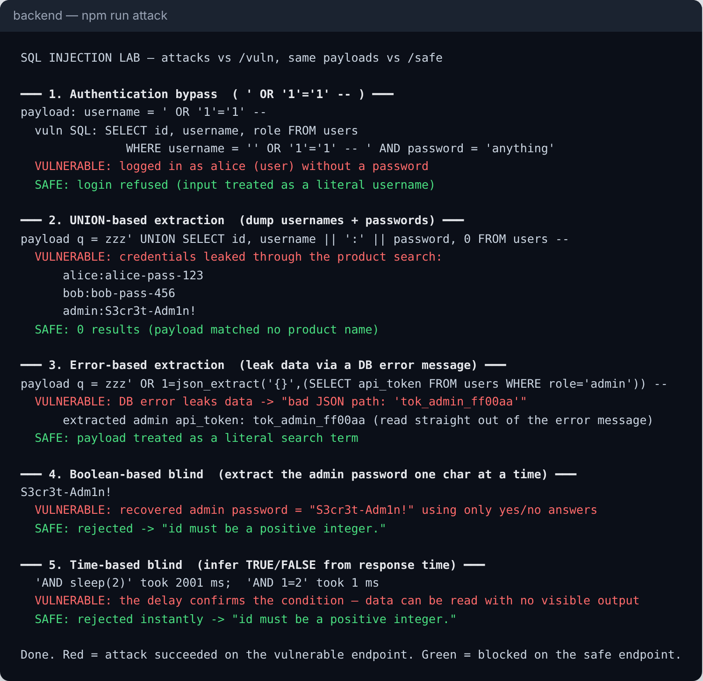
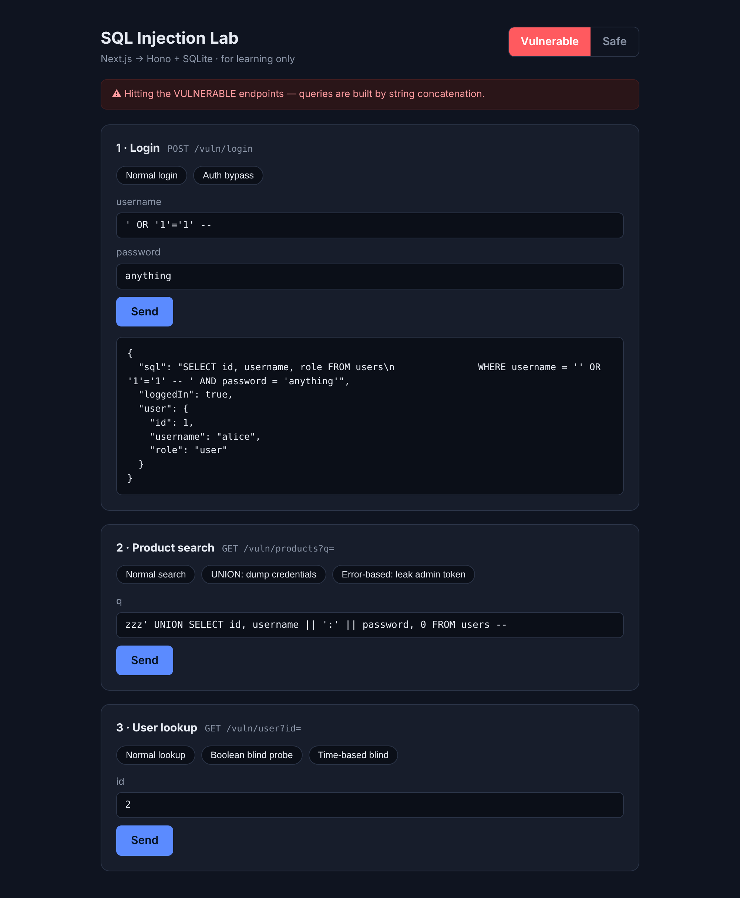
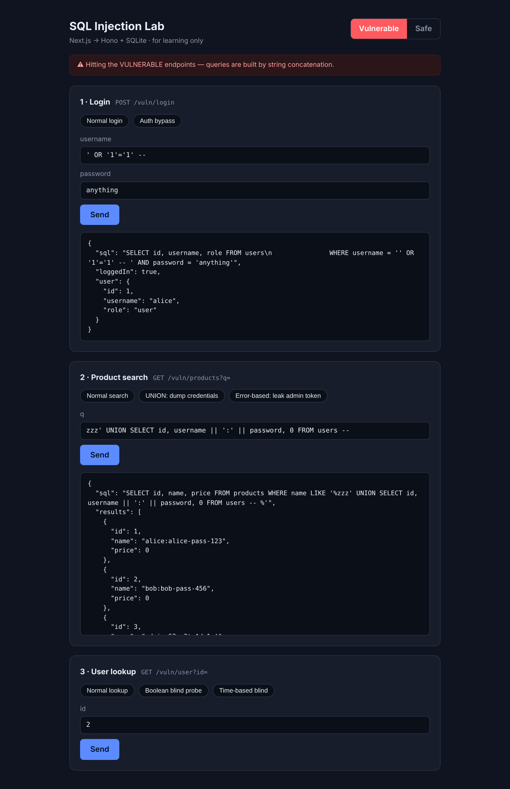
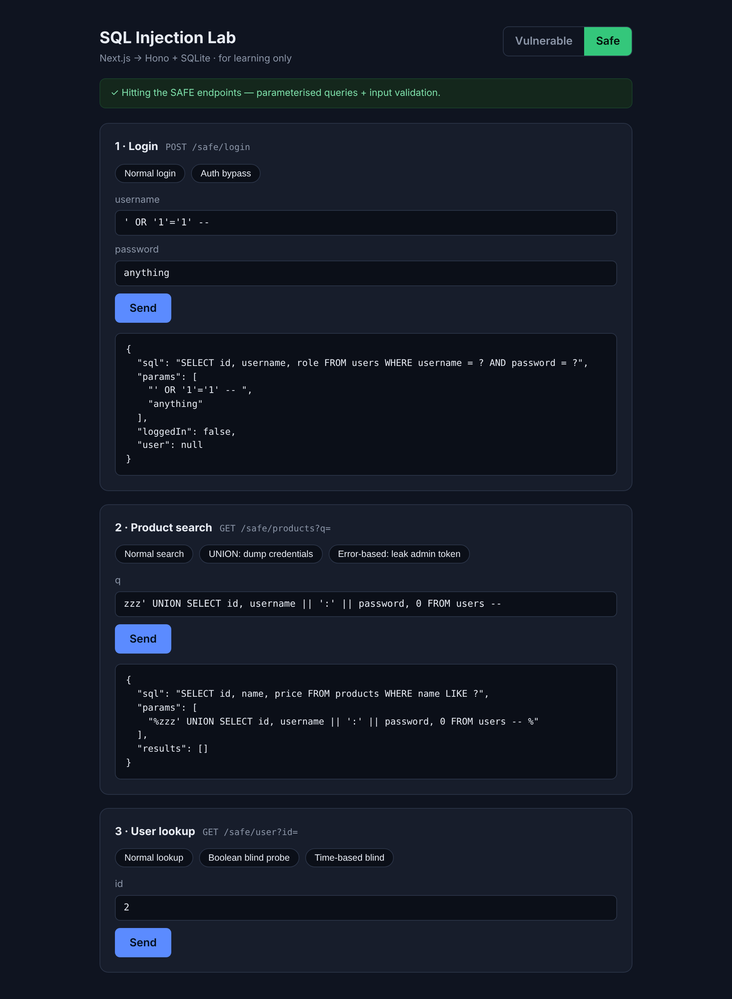

# SQL Injection Lab: attack and defence

**WEB404 Secure Coding Practices: Server-Side Attacks**

A deliberately vulnerable web app and its secured twin, side by side, so you can
run real SQL injection attacks and watch the same payloads fail once the code is
fixed. Every endpoint exists in two versions: `/vuln` (built with string
concatenation) and `/safe` (parameterised queries).

> ⚠️ **For learning only.** The app uses a throwaway in-memory SQLite database
> and binds to `localhost`. Never deploy the `/vuln` routes anywhere reachable,
> and only ever attack this lab, not systems you don't own.



---

## Contents

1. [What is SQL injection?](#1-what-is-sql-injection)
2. [Where the vulnerability occurs](#2-where-the-vulnerability-occurs)
3. [The attacks (with payloads)](#3-the-attacks-with-payloads)
4. [The one fix that stops all of them](#4-the-one-fix-that-stops-all-of-them)
5. [Screenshots](#5-screenshots)
6. [Running the lab](#6-running-the-lab)
7. [Project structure](#7-project-structure)
8. [Checklist](#8-checklist)
9. [References](#9-references)

---

## 1. What is SQL injection?

A web app builds SQL queries to talk to its database. **SQL injection (SQLi)**
happens when user input is placed directly into the query text, so the input can
change the *structure* of the query instead of being treated as a *value*.

The database can't tell the developer's SQL apart from the attacker's SQL, because
by the time it arrives they are one string. The attacker's text becomes code.

It is consistently one of the most serious web vulnerabilities (OWASP Top 10
A03: Injection; **CWE-89**). A successful attack can bypass logins, read or
modify any data in the database, and sometimes take over the server.

### The root cause, in one line

```ts
// VULNERABLE — input becomes part of the SQL
const sql = `SELECT * FROM users WHERE username = '${username}'`;

// SAFE — input is sent separately, as data
const sql = `SELECT * FROM users WHERE username = ?`;
db.prepare(sql).get(username);
```

Walk through what the vulnerable line does when `username` is `' OR '1'='1' -- `:

```sql
SELECT * FROM users WHERE username = '' OR '1'='1' -- '
```

The quote the attacker typed closes the string early, `OR '1'='1'` is always
true, and `--` comments out the rest. The query now returns every user.

---

## 2. Where the vulnerability occurs

SQLi lives at the exact point where a query string is assembled from input. In
this lab that is three handlers in `backend/src/routes/vulnerable.ts`:

| Endpoint | Vulnerable code | Attack it enables |
|---|---|---|
| `POST /vuln/login` | `WHERE username = '${username}' AND password = '${password}'` | Authentication bypass |
| `GET /vuln/products?q=` | `WHERE name LIKE '%${search}%'` | UNION-based and error-based extraction |
| `GET /vuln/user?id=` | `WHERE id = ${id}` | Blind (boolean and time-based) |

Two things make these exploitable:

1. **String concatenation** places input inside the query text.
2. **Returning raw DB errors** to the client (in `/vuln/products`) hands the
   attacker a channel to read data through error messages.

The database is seeded with a `users` table holding usernames, plaintext
passwords and API tokens (plaintext *on purpose*, to make clear what leaks), and
a harmless `products` table that is the public search surface.

---

## 3. The attacks (with payloads)

Run them all with `npm run attack`, try them interactively in the web UI, or
send them by hand with `curl`. Each is shown against `/vuln` (succeeds) and then
`/safe` (blocked).

### 3.1 Authentication bypass

Log in as the first user without knowing any password.

```
username:  ' OR '1'='1' -- 
password:  anything
```

```sql
-- the query the server runs:
SELECT id, username, role FROM users WHERE username = '' OR '1'='1' -- ' AND password = 'anything'
```

The password check is commented out and the `OR` is always true → logged in as
`alice`. **On `/safe`:** the whole string is treated as one username, which
matches no row → `loggedIn: false`.

### 3.2 UNION-based extraction

The product search returns rows to the page, so an attacker appends a second
`SELECT` with the same number of columns to read a *different* table.

```
q =  zzz' UNION SELECT id, username || ':' || password, 0 FROM users -- 
```

The `name` column of the "products" now contains `alice:alice-pass-123`,
`bob:bob-pass-456`, `admin:S3cr3t-Adm1n!`. **On `/safe`:** 0 results, the payload
is just a search term that matches nothing.

### 3.3 Error-based extraction

When the app leaks DB error messages, data can be smuggled out inside them. This
payload makes SQLite complain about a "JSON path" that is actually the admin's
stolen API token:

```
q =  zzz' OR 1=json_extract('{}',(SELECT api_token FROM users WHERE role='admin')) -- 
```

Response: `{"error": "bad JSON path: 'tok_admin_ff00aa'"}` — the token is right
there in the error. **On `/safe`:** no concatenation and no raw errors, so there
is nothing to leak.

> **Note on databases:** each engine leaks differently. SQLite exposes values
> through messages like `bad JSON path`. MySQL classically uses
> `extractvalue(1, concat(0x7e,(SELECT ...)))`, and MSSQL uses type-conversion
> errors. The *lesson* is identical everywhere: **never return raw database
> errors to users.**

### 3.4 Blind SQLi — boolean-based

`GET /vuln/user` returns only `found: true/false`, no data. That single bit is
enough: ask one yes/no question per character and rebuild the secret.

```
id =  3 AND (SELECT substr(password,1,1) FROM users WHERE id=3) = 'S'   → found: true
id =  3 AND (SELECT substr(password,1,1) FROM users WHERE id=3) = 'X'   → found: false
```

Looping over positions and characters recovers the full admin password
`S3cr3t-Adm1n!`. The attack script does exactly this. **On `/safe`:** the `id`
must match `^\d+$`, so the probe is rejected before it reaches SQL.

### 3.5 Blind SQLi — time-based

When the app returns *nothing* different for true vs false, the attacker makes
the database **pause** on "true" and times the response.

```
id =  3 AND sleep(2)    → response takes ~2 s   (condition true)
id =  3 AND 1=2         → response is instant    (condition false)
```

Same yes/no oracle, measured with a stopwatch instead of a flag. (Real engines:
MySQL `SLEEP()`, PostgreSQL `pg_sleep()`, MSSQL `WAITFOR DELAY`. SQLite has none,
so the lab registers a `sleep()` function purely to make this demo realistic —
see `backend/src/db.ts`.) **On `/safe`:** rejected instantly by the integer check.

---

## 4. The one fix that stops all of them

**Parameterised queries** (also called prepared statements). The SQL text and
the data travel to the database separately, so input can never become code.

```ts
// Vulnerable
db.prepare(`SELECT * FROM users WHERE username = '${u}' AND password = '${p}'`).get();

// Safe — the ? placeholders are filled in by the driver, as pure data
db.prepare(`SELECT * FROM users WHERE username = ? AND password = ?`).get(u, p);
```

With parameters, `' OR '1'='1' -- ` is looked up as a literal username. There is
no row whose username is that string, so the login fails. The attacker's quotes
and comments have no power because they are never parsed as SQL.

This lab also shows the supporting defences (defence in depth):

| Defence | Where | Why |
|---|---|---|
| **Parameterised queries** | every handler in `routes/safe.ts` | The real fix: input stays data. |
| **Input validation (allowlist)** | `/safe/user` requires `^\d+$` | Rejects non-numeric ids before the DB. |
| **No raw errors to the client** | `/safe/products` returns a generic message | Removes the error-based channel. |
| **Least privilege** *(note)* | — | The app's DB account should only read/write the tables it needs, so a breach is contained. |
| **Don't store plaintext secrets** *(note)* | — | Passwords should be hashed (see the file-upload project). Shown in plaintext here only to make leaks obvious. |

> Parameterisation covers values. Where user input must select a **column or
> table name** (which can't be a parameter), validate it against a fixed
> allowlist of permitted names — never concatenate it.

---

## 5. Screenshots

### Authentication bypass on the vulnerable endpoint
Logged in as `alice` with no valid password; the response shows the injected SQL.



### UNION-based extraction dumping every credential


### The same payloads on the safe endpoints
`loggedIn: false` and `results: []`. The payload is visible as a literal
parameter, exactly where data belongs.



### All five attacks, scripted


---

## 6. Running the lab

**Requirements:** Node.js 20+.

```bash
# 1. Backend (the vulnerable + safe API)
cd backend
npm install
npm run dev            # http://localhost:8080

# 2. Run every attack from the command line (server must be running)
npm run attack

# 3. (optional) Interactive web playground
cd ../frontend
npm install
npm run dev            # http://localhost:3000
```

In the web UI, use the **Vulnerable / Safe** toggle (top right) and the payload
chips to fire each attack and compare the two responses.

### Try one by hand

```bash
# Auth bypass
curl -s localhost:8080/vuln/login -H 'content-type: application/json' \
  -d '{"username":"'\'' OR '\''1'\''='\''1'\'' -- ","password":"x"}'

# UNION extraction
curl -s "localhost:8080/vuln/products?q=zzz'%20UNION%20SELECT%20id,%20username%20||%20':'%20||%20password,%200%20FROM%20users%20--%20"

# the same against /safe returns nothing useful
```

---

## 7. Project structure

```
sqli-lab/
├── backend/
│   ├── src/
│   │   ├── db.ts                 in-memory SQLite, seed data, demo sleep()
│   │   ├── routes/
│   │   │   ├── vulnerable.ts     ⚠️  string-concatenated queries (the bugs)
│   │   │   └── safe.ts           ✅  parameterised queries (the fixes)
│   │   └── server.ts             Hono app: mounts /vuln and /safe
│   └── scripts/attack.ts         runs all 5 attacks vs /vuln and /safe
├── frontend/                     Next.js playground with a vuln/safe toggle
│   └── src/app/page.tsx
└── docs/screenshots/
```

The `vulnerable.ts` and `safe.ts` files are deliberately line-for-line
comparable: open them side by side to see that the only real difference is
concatenation vs `?` placeholders.

---

## 8. Checklist

- [ ] **Use parameterised queries / prepared statements for every query.** This is the primary defence.
- [ ] Use an ORM or query builder safely — and never drop back to raw string concatenation for the "tricky" query.
- [ ] Validate and constrain input (type, length, allowlist) as defence in depth, not as the only defence.
- [ ] For dynamic column/table/sort names, match against a fixed allowlist — they can't be parameters.
- [ ] Never return raw database errors to the client; log them server-side and show a generic message.
- [ ] Apply least privilege to the database account the app uses.
- [ ] Hash passwords and keep secrets out of tables that user-facing queries can reach.
- [ ] Add a WAF and monitoring as extra layers, but never as a substitute for parameterisation.

---

## 9. References

- [OWASP: SQL Injection](https://owasp.org/www-community/attacks/SQL_Injection)
- [OWASP: SQL Injection Prevention Cheat Sheet](https://cheatsheetseries.owasp.org/cheatsheets/SQL_Injection_Prevention_Cheat_Sheet.html)
- [OWASP Top 10 — A03:2021 Injection](https://owasp.org/Top10/A03_2021-Injection/)
- [CWE-89: Improper Neutralization of Special Elements used in an SQL Command](https://cwe.mitre.org/data/definitions/89.html)
- [PortSwigger Web Security Academy: SQL injection](https://portswigger.net/web-security/sql-injection)
