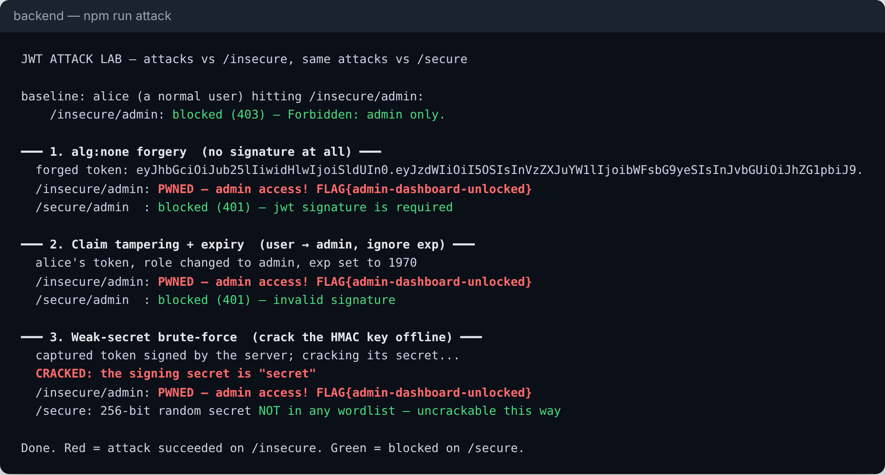
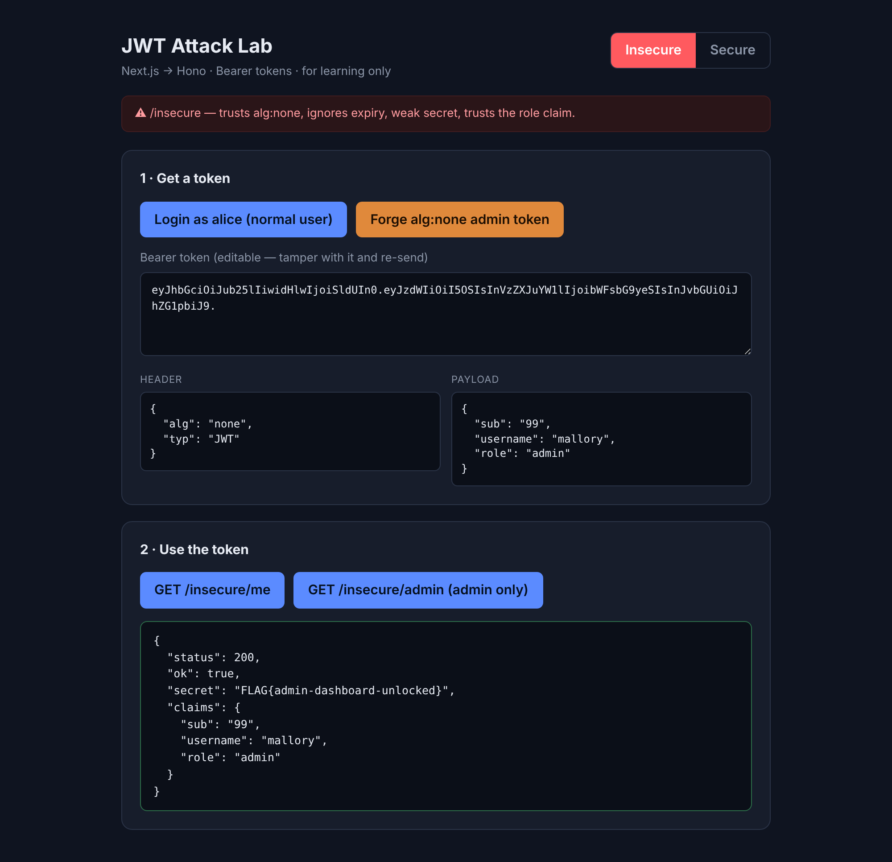
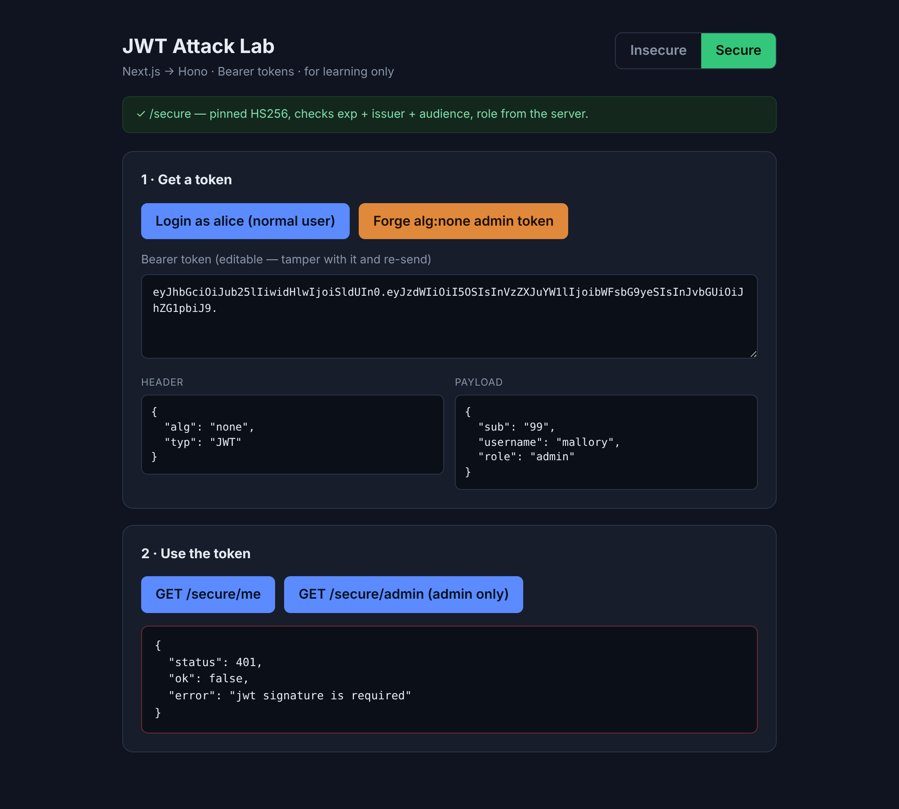

# JWT Authentication Lab: attack and secure handling

**WEB404 Secure Coding Practices: Server-Side Attacks**

A JWT-based authentication system built twice, side by side: an **insecure**
version with the mistakes that make the classic JWT attacks work, and a
**secure** version that blocks them. A script and a web playground run each
attack against both so you can see exactly what changes.

> ⚠️ **For learning only.** The `/insecure` world is intentionally broken. It
> uses an in-memory user store and binds to `localhost`. Never deploy it, and
> only ever attack this lab, not systems you don't own.



---

## Contents

1. [What is JWT authentication?](#1-what-is-jwt-authentication)
2. [Where JWT vulnerabilities occur](#2-where-jwt-vulnerabilities-occur)
3. [The attacks (with payloads)](#3-the-attacks-with-payloads)
4. [Secure JWT handling](#4-secure-jwt-handling)
5. [Screenshots](#5-screenshots)
6. [Running the lab](#6-running-the-lab)
7. [Project structure](#7-project-structure)
8. [Checklist](#8-checklist)
9. [References](#9-references)

---

## 1. What is JWT authentication?

A **JSON Web Token (JWT)** is a signed string a server gives a client after
login. The client sends it back on later requests (here, in the
`Authorization: Bearer <token>` header) to prove who it is, so the server
doesn't have to keep a session in memory.

A JWT has three base64url parts separated by dots: `header.payload.signature`

```
eyJhbGciOiJIUzI1NiJ9 . eyJzdWIiOiIxIiwicm9sZSI6InVzZXIifQ . 4f3a...
└── header ──┘          └──────── payload (claims) ───────┘   └ signature ┘
{"alg":"HS256"}         {"sub":"1","role":"user","exp":...}
```

- **header** — which algorithm signs the token (e.g. `HS256`).
- **payload** — the *claims*: who the user is (`sub`), their `role`, when the
  token expires (`exp`), who issued it (`iss`), who it's for (`aud`).
- **signature** — an HMAC (for `HS256`) over `header.payload` using a secret
  only the server knows. It proves the token hasn't been changed.

**The crucial point:** the header and payload are only *encoded*, not
*encrypted*. Anyone can read and edit them. The **only** thing stopping an
attacker from changing `role` to `admin` is the server correctly checking the
signature. Every attack below is a way to get the server to skip or defeat that
check.

---

## 2. Where JWT vulnerabilities occur

JWT bugs live in **verification**, not in issuing. In this lab the vulnerable
verifier is `backend/src/tokens.ts → insecureVerify()`, and it contains the four
mistakes that enable the three attacks:

| Mistake in `insecureVerify` | Attack it enables |
|---|---|
| Trusts `alg: "none"` and skips the signature | alg:none forgery |
| Takes the algorithm from the token header instead of pinning it | algorithm confusion (same root cause) |
| `ignoreExpiration: true` — never checks `exp` | expired-token replay |
| Reads `role` straight from the token and trusts it | privilege escalation via claim tampering |

Plus a configuration mistake in `config.ts`: the HMAC secret is the word
`"secret"` — short, guessable, and in every wordlist. That enables the
brute-force attack.

The lab exposes two protected endpoints in each world so you can see the impact:

| Endpoint | Who should reach it |
|---|---|
| `GET /{world}/me` | any authenticated user |
| `GET /{world}/admin` | admins only — returns a "flag" on success |

---

## 3. The attacks (with payloads)

Run them all with `npm run attack`, or try them in the web playground. Each is
shown succeeding on `/insecure` and blocked on `/secure`.

### 3.1 `alg: none` forgery

The JWT spec allows an algorithm of `none`, meaning "unsigned". A verifier that
honours it will accept *any* payload with no signature at all. The attacker
builds an admin token by hand — no secret needed:

```
header:    {"alg":"none","typ":"JWT"}
payload:   {"sub":"99","username":"mallory","role":"admin"}
signature: (empty)

token = base64url(header) + "." + base64url(payload) + "."
```

Sent to `/insecure/admin` → **admin access granted**. On `/secure/admin` the
algorithm is pinned to `HS256`, so the library rejects it: *"jwt signature is
required"*.

### 3.2 Claim tampering + expiry replay

The attacker takes a normal user's token, flips `role` to `admin`, and sets
`exp` to a time long past (proving the server ignores expiry). Because the
insecure secret is known/weak, they re-sign it:

```
payload:  {"sub":"1","username":"alice","role":"admin","exp":1}   // exp = 1970
```

Sent to `/insecure/admin` → **admin access**, even though the token "expired" in
1970. On `/secure`: the signature doesn't match the strong secret *and* `exp` is
enforced, so it's rejected.

> This is also why a server must never make an **authorization** decision from a
> claim alone. The secure side re-loads the user and uses the role from its own
> store, so even a perfectly-signed token can't grant a role the user doesn't have.

### 3.3 Weak-secret brute-force

`HS256` signs with a shared secret. If that secret is weak, an attacker who
captures *one* token can crack it **offline** — no requests to the server — by
trying a wordlist until a guess reproduces the signature:

```ts
for (const guess of wordlist)
  if (hmacSHA256(`${header}.${payload}`, guess) === signature) found = guess;
// → the secret is "secret"
```

With the secret recovered, they mint a fully valid admin token that passes even
a *correct* signature check. On `/secure`, the secret is 256 bits of randomness
and isn't in any wordlist, so the same attack finds nothing.

---

## 4. Secure JWT handling

The secure verifier (`tokens.ts → secureVerify()`) and config fix every issue:

```ts
jwt.verify(token, STRONG_SECRET, {
  algorithms: ["HS256"],   // PIN the algorithm → rejects "none" and confusion
  issuer: ISSUER,          // token must come from us
  audience: AUDIENCE,      // token must be meant for us
});                        // exp is enforced by default → no replay
// then: re-load the user and use the role from the DB, not the token
```

| Defence | What it stops | Where |
|---|---|---|
| **Pin `algorithms`** to an explicit allowlist | alg:none, algorithm confusion | `secureVerify` |
| **Strong random secret** (256-bit), from env/secrets manager | brute-force | `config.ts` → `STRONG_SECRET` |
| **Verify, never just decode** the signature | all tampering | `secureVerify` uses `jwt.verify` |
| **Enforce `exp`** (short-lived tokens) | expired/stolen-token replay | `expiresIn` + default verify |
| **Check `iss` / `aud`** | tokens minted for/by another service | `secureVerify` |
| **Re-check authorization server-side** | privilege escalation via claims | role read from the user store |

Additional practices noted in the lab but beyond its scope:

- **Transport & storage:** always send tokens over HTTPS. A token in the
  `Authorization` header (as here) must be kept out of `localStorage` if the
  site has any XSS risk; an **HttpOnly cookie** (as in the file-upload project)
  protects it from JavaScript but then needs CSRF defences.
- **Short access tokens + refresh tokens:** keep access tokens to minutes and
  use a separate, rotated refresh token for longer sessions.
- **Revocation:** plain JWTs can't be "logged out" before they expire. For
  that, keep a server-side denylist of token IDs (`jti`) or use short lifetimes.
- **Don't put secrets in the payload** — it's readable by anyone.

---

## 5. Screenshots

### alg:none forgery unlocks the admin endpoint (insecure)
The forged token's header shows `"alg": "none"` and the payload `"role":
"admin"`; `/insecure/admin` returns the flag.



### The same forged token is rejected (secure)
`/secure/admin` returns `401 — jwt signature is required`.



### All three attacks, scripted


---

## 6. Running the lab

**Requirements:** Node.js 20+.

```bash
# 1. Backend (the insecure + secure API)
cd backend
npm install
npm run dev            # http://localhost:8090

# 2. Run every attack from the command line (server must be running)
npm run attack

# 3. (optional) Interactive web playground
cd ../frontend
npm install
npm run dev            # http://localhost:3000
```

Demo users: `alice` / `alice-pass-123`, `bob` / `bob-pass-456`,
`admin` / `S3cr3t-Adm1n!`.

### Try one by hand

```bash
# Forge an alg:none admin token and hit the insecure admin endpoint:
H=$(printf '{"alg":"none","typ":"JWT"}'      | basenc --base64url | tr -d '=')
P=$(printf '{"sub":"99","role":"admin"}'     | basenc --base64url | tr -d '=')
curl -s localhost:8090/insecure/admin -H "Authorization: Bearer $H.$P."
# → {"ok":true,"secret":"FLAG{admin-dashboard-unlocked}",...}

# The same token against the secure endpoint:
curl -s localhost:8090/secure/admin   -H "Authorization: Bearer $H.$P."
# → {"ok":false,"error":"jwt signature is required"}
```

---

## 7. Project structure

```
jwt-lab/
├── backend/
│   ├── src/
│   │   ├── config.ts       weak vs strong secret, issuer/audience, TTL
│   │   ├── users.ts        in-memory user store (source of truth for roles)
│   │   ├── tokens.ts       ⚠️ insecureVerify()  vs  ✅ secureVerify()
│   │   └── server.ts       Hono app: /insecure and /secure worlds
│   └── scripts/attack.ts   runs all 3 attacks vs both worlds
├── frontend/               Next.js playground: login, token decoder, forge button
│   └── src/app/page.tsx
└── docs/screenshots/
```

`insecureVerify` and `secureVerify` sit in the same file so you can read them
side by side — the difference is the whole lesson.

---

## 8. Checklist

- [ ] **Always verify the signature** (`jwt.verify`), never just decode the payload.
- [ ] **Pin the algorithm** to an explicit allowlist; never trust the token's `alg` header, and never allow `none`.
- [ ] Use a **long, random secret** (256-bit+) for HS256, from a secrets manager — never a word or a short string.
- [ ] If you use RS256/ES256, verify with the **public key** and reject HS* tokens (prevents algorithm confusion).
- [ ] **Enforce `exp`**, keep access tokens short-lived, and check `iss` / `aud`.
- [ ] Make **authorization decisions server-side**, from your own data — treat claims as hints, not facts.
- [ ] Send tokens only over **HTTPS**; weigh HttpOnly cookie (CSRF) vs header/storage (XSS) for your threat model.
- [ ] Have a **revocation** story: short lifetimes, refresh-token rotation, or a `jti` denylist.
- [ ] Never put secrets or sensitive data in the payload — it's readable by anyone.

---

## 9. References

- [OWASP: JSON Web Token Cheat Sheet](https://cheatsheetseries.owasp.org/cheatsheets/JSON_Web_Token_for_Java_Cheat_Sheet.html)
- [OWASP Top 10 — A07:2021 Identification and Authentication Failures](https://owasp.org/Top10/A07_2021-Identification_and_Authentication_Failures/)
- [PortSwigger Web Security Academy: JWT attacks](https://portswigger.net/web-security/jwt)
- [RFC 8725: JSON Web Token Best Current Practices](https://datatracker.ietf.org/doc/html/rfc8725)
- [CWE-347: Improper Verification of Cryptographic Signature](https://cwe.mitre.org/data/definitions/347.html)
- [Auth0: jsonwebtoken library](https://github.com/auth0/node-jsonwebtoken)
